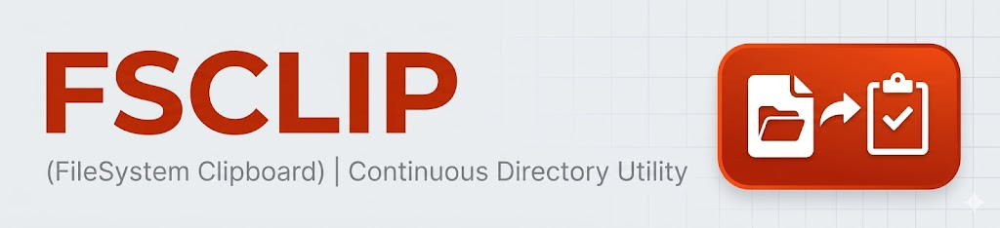

A tiny filesystem “clipboard bridge” that watches a directory and automatically places any dropped file's contents on your system clipboard — then cleans up after itself.


FSClip ("FileSystem Clipboard") gives you a friction‑free way to get data into the clipboard when the producing application can only save to disk. Drop (or programmatically write) a file into a special watched directory (default: ~/copy-to-clipboard/) and the file's contents are copied to your clipboard and the file is removed. Ideal for export‑only GUI apps.

## Why?

Some tools can only emit output as files. If your next step is to paste that output into chat, an editor, an email, or a web form, manually opening the file and copying its contents gets repetitive fast.

## Key Features
* Zero friction workflow – Just write or drag files into the watched directory
* Auto copy & prune – Contents are copied; the original file is deleted
* Text & Image modes - Either copies files as text or as image
* Minimal footprint – Single small executable

## Installation
### Mac

```bash
sh -c "$(curl -fsLS https://github.com/N-Silbernagel/fs-clip/releases/latest/download/install.sh)"
```

### Linux/Windows
There is no installer for now. Download the archives from the releases tab and install the binary your preferred way.

## Configuration

Use 
```bash
sh -c "$(curl -fsLS https://github.com/N-Silbernagel/fs-clip/releases/latest/download/install.sh)" -- -w YOUR_DIRECTORY
``` 

to configure a different directory to watch during installation (you can just reinstall fs-clip if it is already installed)

## How It Works

At its core FSClip watches a directory for new files
1. Detect new file
2. Read file contents
3. Write to system clipboard
4. Delete the source file after a successful copy

Files that cannot be read or copied, and files with unsupported content types, are kept in the watched directory.

## Roadmap
* Cross-platform packaged binaries
* Ignore patterns (e.g. .DS_Store)
* Tests + CI badges
* Release automation (GitHub Actions)
* Add configuration for file deletion

## Building from source

Requires Go 1.27.3 or newer and a graphical desktop session for clipboard access.

```bash
go build .
go test -race ./...
go vet ./...
```

## Clipboard integration tests

GitHub Actions runs unit tests, static checks, and clipboard integration tests on
Ubuntu, macOS, and Windows. Each integration job first checks native clipboard
write/read access, then starts the built application and verifies:

- Unicode text is copied completely and its source is removed.
- A file written in chunks remains present during writing and is copied completely.
- Unsupported files retain their contents and leave the clipboard unchanged.
- PNG images retain their dimensions and pixels on the clipboard.
- A subsequent file at a previously used path replaces the clipboard contents.

Clipboard access failures fail the job rather than skipping the tests. Image
assertions use Go's PNG decoder to compare pixels read through native clipboard tools.

The same jobs exercise the installers against a local release server: latest and
explicit tags, repeat installs, custom paths, and invalid or missing checksums.
They then run the clipboard suite against the installed executable. Service-manager
commands are recorded and generated service files are checked; these tests do not
verify service startup at login. macOS and Windows installer coverage is verified
when their CI jobs pass.

## Contributing

PRs, issues, and discussions welcome!

## Security & Privacy

FSClip reads files you intentionally place into the watched directory. It does not traverse elsewhere.

## Acknowledgments

FSClip builds on the excellent work of these open-source projects:

- **[golang-design/clipboard](https://github.com/golang-design/clipboard)** – cross-platform clipboard support for Go
- **[fsnotify/fsnotify](https://github.com/fsnotify/fsnotify)** – filesystem event notifications for Go

## License

Distributed under the MIT License. See LICENSE.txt for details.
